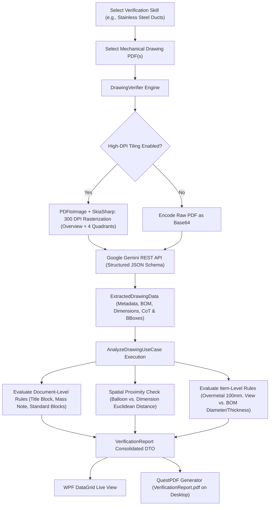

# DrawingVerifier

[](https://dotnet.microsoft.com/)
[](https://learn.microsoft.com/dotnet/csharp/)
[](https://learn.microsoft.com/dotnet/desktop/wpf/)
[](https://ai.google.dev/)
[](https://www.questpdf.com/)
[](https://www.litedb.org/)
[](LICENSE)

**DrawingVerifier** is an intelligent desktop application for Windows (.NET 9 / WPF) designed to automate the technical audit and compliance verification of mechanical fabrication drawings in PDF format.

Combining **Google Gemini Multimodal Vision AI** with a local **NCalc dynamic mathematical rules engine**, DrawingVerifier eliminates tedious manual audits by automatically extracting title block metadata, Bill of Materials (BOM) tables, view callouts, overmetal allocations, and geometric dimensions. It runs cross-referencing validation rules locally, validates spatial proximity between leader lines and balloons, and produces audit-ready compliance PDF reports in seconds.

---

## Table of Contents

- [Key Capabilities](#key-capabilities)
- [How It Works](#how-it-works)
- [System Architecture](#system-architecture)
- [Tech Stack](#tech-stack)
- [Prerequisites](#prerequisites)
- [Getting Started](#getting-started)
- [Application Walkthrough](#application-walkthrough)
- [Verification Rules & Skills](#verification-rules--skills)
- [Security & Credential Storage](#security--credential-storage)
- [Building & Publishing](#building--publishing)
- [Continuous Integration & Delivery](#continuous-integration--delivery)
- [Documentation Directory](#documentation-directory)
- [Contributing](#contributing)
- [License](#license)

---

## Key Capabilities

- **High-DPI Multimodal AI Extraction (300 DPI Tiling):**
  Rasterizes technical drawings at 300 DPI and decomposes large sheets (A0/A1) into four overlapping quadrants (with 15% margin overlap) plus an overview sheet. This guarantees crisp resolution on fine dimension text, tolerance callouts, and dense bill-of-materials tables without AI token distortion.
- **Visual Chain-of-Thought (CoT) & Spatial Bounding Boxes:**
  Instructs Gemini to mentally trace leader lines from balloon circles to specific duct segments. Extracts normalized bounding boxes (`[ymin, xmin, ymax, xmax]` in range 0–1000) for both balloons and dimensions, triggering automated spatial proximity checks to flag disconnected callouts.
- **Dynamic Mathematical Rules Engine (NCalc):**
  Audits drawings against customizable client and engineering standards. Formulate custom checks using boolean/algebraic expressions (`if(PossuiSobremetal, ValorSobremetal == 100, true)`), automatically evaluated against extracted document and item-level parameters.
- **Dynamic Error Interpolation:**
  Provides human-readable feedback by dynamically injecting runtime values into error message templates (e.g., `"[Balloon {BalaoRef}] Overmetal indicated is {ValorSobremetal}mm (Expected: 100mm)"`).
- **Client Verification Skills (Profiles):**
  Create, clone, edit, and maintain isolated verification profiles for different engineering specifications (e.g., industrial ducting, piping standards, structural skids) stored in an embedded LiteDB database.
- **Bank-Grade Credential Protection (Windows DPAPI):**
  Stores Google Gemini API keys securely using the Windows Data Protection API (DPAPI) scoped to the current Windows user profile with hidden file attributes.
- **Automated Audit PDF Reports (QuestPDF):**
  Compiles verification runs across single or batch drawings into a cleanly styled, publication-ready PDF report saved directly to your Desktop.

---

## How It Works



---

## System Architecture

DrawingVerifier strictly follows **Clean Architecture** and **MVVM** principles, ensuring modularity, testability, and separation of concerns:

```
DrawingVerifier.sln
├── src/
│   ├── DrawingVerifier.Domain/         # Core business entities, value objects, and repository interfaces
│   ├── DrawingVerifier.Application/    # Orchestrator use cases, rule evaluation logic, and DTOs
│   ├── DrawingVerifier.Infrastructure/ # LiteDB persistence, Gemini HTTP client, SkiaSharp tiling, QuestPDF
│   └── DrawingVerifier.UI/             # Windows Presentation Foundation (WPF) views and ViewModels
├── tests/
│   └── DrawingVerifier.Tests/          # Unit and integration tests (xUnit)
└── docs/                               # Comprehensive subsystem documentation
```

### Layer Responsibilities

1. **`DrawingVerifier.Domain`**
   - Independent of external frameworks.
   - Contains core entities: `VerificationSkill`, `ValidationRule`, `ExtractedDrawingData`, `DrawingMetadata`, `ExtractedBomItem`, `ExtractedDimension`.
   - Defines interfaces: `ISkillRepository`, `IGeminiApiService`.
2. **`DrawingVerifier.Application`**
   - Implements use cases: `AnalyzeDrawingUseCase`.
   - Evaluates dynamic expressions via `IRuleEvaluator` and `NCalcRuleEvaluator`.
   - Manages parameter mapping and error template interpolation.
3. **`DrawingVerifier.Infrastructure`**
   - Implements `ISkillRepository` using **LiteDB NoSQL** (`DrawingVerifier.db`).
   - Implements `IGeminiApiService` via `GeminiApiHttpClient` targeting Google Gemini Generative Language v1beta API.
   - Implements `IPdfRasterizerService` using **PDFtoImage** and **SkiaSharp**.
   - Implements `ISettingsService` using **Windows DPAPI** (`WindowsSettingsService`).
   - Generates vector PDF reports via **QuestPDF** (`QuestPdfReportGenerator`).
   - Database seeding and automatic schema migrations via `DatabaseSeeder`.
4. **`DrawingVerifier.UI`**
   - Modern WPF interface utilizing `CommunityToolkit.Mvvm`.
   - Views: `MainWindow`, `SettingsWindow`, `SkillManagerWindow`.
   - ViewModels: `MainViewModel`, `SettingsViewModel`, `SkillManagerViewModel`.
   - Dependency Injection setup via `Microsoft.Extensions.DependencyInjection`.

---

## Tech Stack

| Component | Technology | Version | Description |
| :--- | :--- | :--- | :--- |
| **Framework** | .NET | 9.0 | High-performance managed runtime |
| **Language** | C# | 13.0 | Modern language features (primary constructors, records, collection expressions) |
| **Desktop UI** | WPF | .NET 9 Desktop | Windows Presentation Foundation |
| **MVVM Framework** | CommunityToolkit.Mvvm | 8.4.2 | Observable properties, Relay commands, INotifyPropertyChanged source generators |
| **Vision AI** | Google Gemini API | v1beta | Multimodal LLM (`gemini-3.8-flash`, `gemini-4-argon`, `gemini-3.5-flash-lite`) |
| **Rules Engine** | NCalcSync | 7.2.0 | Dynamic mathematical and boolean expression evaluation |
| **PDF Rasterizer** | PDFtoImage & SkiaSharp | 5.4.0 | High-DPI PDF page rasterization and coordinate cropping |
| **PDF Reporting** | QuestPDF | 2026.9.1 | Fluent C# vector PDF document generation |
| **Embedded DB** | LiteDB | 5.0.21 | Single-file embedded NoSQL document database |
| **Security** | System.Security.Cryptography.ProtectedData | 9.0.2 | Windows Data Protection API (DPAPI) |
| **Unit Testing** | xUnit & coverlet | 2.9.3 | Unit test runner and coverage collector |

---

## Prerequisites

- **Operating System:** Windows 10 (1809+) or Windows 11 (x64)
- **Runtime:** [.NET 9.0 Desktop Runtime](https://dotnet.microsoft.com/download/dotnet/9.0) (or the .NET 9.0 SDK for developers)
- **API Access:** A valid [Google Gemini API Key](https://aistudio.google.com/app/apikey)

---

## Getting Started

### 1. Clone the Repository
```bash
git clone https://github.com/gmataleite/DrawingVerifier.git
cd DrawingVerifier
```

### 2. Build the Solution
```powershell
dotnet build
```

### 3. Run Unit Tests
```powershell
dotnet test
```

### 4. Launch the Application
```powershell
dotnet run --project src/DrawingVerifier.UI/DrawingVerifier.UI.csproj
```

---

## Application Walkthrough

### 1. First-Time Setup: Configure API Key & Options
1. Click **Settings** in the top-right corner of the main window.
2. Enter your Google Gemini API Key.
3. Choose your preferred Gemini Model:
   - `gemini-3.8-flash` *(Recommended default: gold standard for speed, reasoning, and visual extraction)*
   - `gemini-4-argon` *(Maximum visual reasoning depth and complex geometric logic)*
   - `gemini-3.5-flash-lite` *(Ultra-high efficiency for high-volume batch processing)*
4. Ensure **Enable High-DPI Quadrant Tiling (300 DPI)** is checked for large mechanical drawings (A0/A1/A2 formats).
5. Click **Save**. Your credentials are encrypted immediately with Windows DPAPI.

### 2. Choose or Customize a Verification Skill
1. Select a skill from the **Verification Skill** dropdown (defaults to `"Stainless Steel Ducts"`).
2. To modify rules, prompt instructions, or JSON Schemas, click **Manage Skills**.
3. In the **Skill & Rules Manager**:
   - Inspect the **System Prompt** guiding Gemini's visual focus.
   - Modify the strict **Output Schema (JSON)** contract.
   - Add, edit, or delete **NCalc validation rules** with live expression syntax checking.
   - Click **Save Changes**.

### 3. Run Verification
1. Click **Add PDF Files...** and pick one or more mechanical drawing PDF files.
2. Click **Run Verification**.
3. DrawingVerifier will:
   - Render the PDF and submit the imagery alongside the skill's instructions and schema to Gemini.
   - Parse the structured JSON response into domain models.
   - Perform spatial proximity audits between balloon references and dimensions.
   - Evaluate all document-level and item-level validation rules.
   - Populate the results DataGrid with real-time pass/fail indicators, error counts, and warnings.
   - Automatically compile a consolidated **`VerificationReport.pdf`** and save it directly to your **Desktop**.

---

## Verification Rules & Skills

DrawingVerifier comes pre-seeded with industrial fabrication rules for stainless steel ventilation and ducting:

| Rule Name | NCalc Expression | Error Condition Flagged |
| :--- | :--- | :--- |
| **Check Title Block Fields** | `CamposLegendaVaziosCount == 0` | Missing mandatory metadata (Client, Drawing No., Drawn By, Approved By). |
| **Check Total Mass Note** | `MassaTotalNotaKg > 0` | Note missing, zero, or left as `"N/A"`. Requires actual 3D model calculated value. |
| **Compare Mass (BOM vs Note)** | `if(MassaTotalNotaKg > 0 && SomaMassaBomKg > 0, Abs(MassaTotalNotaKg - SomaMassaBomKg) < (MassaTotalNotaKg * 0.05), true)` | Declared approximate note mass deviates by >5% from the sum of BOM item masses. |
| **Overmetal Must Be 100mm** | `if(PossuiSobremetal, ValorSobremetal == 100, true)` | Non-standard overmetal specified (e.g., +50mm instead of mandatory +100mm). |
| **Overmetal Length Math** | `if(PossuiSobremetal && CotaBase > 0 && ComprimentoBom > 0, ComprimentoBom == CotaBase + 100, true)` | BOM cut length does not equal view nominal dimension + 100mm. |
| **Diameter Match (View vs BOM)** | `if(DiametroVista > 0 && DiametroBom > 0, DiametroVista == DiametroBom, true)` | Inner diameter in view does not match BOM diameter column. |
| **Thickness Match (View vs BOM)** | `if(EspessuraVista > 0 && EspessuraBom > 0, EspessuraVista == EspessuraBom, true)` | Plate thickness in view callout does not match BOM thickness column. |
| **Mandatory Standard Blocks** | `PossuiBlocoSoldaTopo && PossuiBlocoReferenciaChapas && PossuiBlocoRugosidade` | Missing mandatory shop blocks (Butt Weld, Sheet Ref, Roughness 0.8µm). |
| **Orphan Connection Ends** | `ExtremidadesSemConexao == 0` | Duct ends without leader notes indicating mating interfaces. |
| **All BOM Items Ballooned** | `ItensBomSemBalaoCount == 0` | BOM items without corresponding identification balloons on views. |

For detailed information on writing expressions and using variables, refer to the [Rules Engine Guide](docs/RULES_ENGINE.md).

---

## Security & Credential Storage

DrawingVerifier adheres to enterprise desktop security guidelines:
- **Zero Plaintext Secrets:** Sensitive API keys are never stored in plain text configuration files, registry values, or environment variables.
- **Windows DPAPI Encryption:** The API key is encrypted using `ProtectedData.Protect` under `DataProtectionScope.CurrentUser` and saved to `%LocalAppData%\DrawingVerifier\settings.dat`.
- **User Isolation:** The encryption key is tied to the Windows security account password and hardware TPM. No other Windows user on the same machine can decrypt the stored key.
- **No Remote Telemetry:** Application preferences, database contents, and logs remain strictly local on the client machine.

---

## Building & Publishing

### Self-Contained Single-File Executable (win-x64)
Produce a standalone `.exe` containing all .NET 9 runtimes, SkiaSharp binaries, and WPF dependencies:

```powershell
dotnet publish src/DrawingVerifier.UI/DrawingVerifier.UI.csproj `
  -c Release `
  -r win-x64 `
  --self-contained true `
  -p:PublishSingleFile=true `
  -p:IncludeNativeLibrariesForSelfExtract=true `
  -p:IncludeAllContentForSelfExtract=true `
  -o ./publish
```

The resulting `DrawingVerifier.UI.exe` can be distributed directly to client machines without requiring .NET 9 to be pre-installed.

---

## Continuous Integration & Delivery

The project includes pre-configured GitHub Actions workflows in `.github/workflows/`:

- **CI Pipeline (`ci.yml`):**
  Triggers on pull requests to `main` and `master`. Restores dependencies, compiles the entire solution on `windows-latest`, and verifies build integrity.
- **CD Release Pipeline (`release.yml`):**
  Triggers automatically on tag pushes (`v*`) or merges to `main`. Reads semantic versions from `Directory.Build.props`, builds self-contained single-file win-x64 binaries, compresses them into `.zip` archives, and generates official GitHub Releases with downloadable assets and release notes.

---

## Documentation Directory

Explore the dedicated documentation guides for deeper technical insights:

- 🏛️ [**Architecture & Design Guide**](docs/ARCHITECTURE.md): Comprehensive Clean Architecture breakdown, component interaction diagrams, data flow sequences, and design decisions.
- 📐 [**Rules Engine Guide**](docs/RULES_ENGINE.md): Syntax reference for NCalc, parameter dictionary, functions, and recipe examples for industrial validation.
- 🎯 [**Skills & Prompts Guide**](docs/SKILLS_GUIDE.md): Creating custom client profiles, structuring system prompts, defining JSON Schemas, visual Chain-of-Thought, and spatial coordinates.
- 🔑 [**API, Tiling & Settings Guide**](docs/API_AND_SETTINGS.md): Gemini API integration, multimodal quadrant tiling mechanics (300 DPI), and Windows DPAPI storage.
- 📖 [**User Manual**](docs/USER_GUIDE.md): End-user operations guide for quality assurance engineers and draftspersons.
- 🤝 [**Contributing & Developer Workflow**](docs/CONTRIBUTING.md): Git branching conventions, Conventional Commits, testing standards, and local development setup.

---

## Contributing

We welcome contributions! Please review our [Contributing Guide](docs/CONTRIBUTING.md) and adhere to our strict branch workflow:
1. Create a feature or fix branch from `main`: `feature/your-feature-name` or `fix/your-fix-name`.
2. Ensure code compiles cleanly with `dotnet build` and all tests pass with `dotnet test`.
3. Use [Conventional Commits](https://www.conventionalcommits.org/) (`feat:`, `fix:`, `docs:`, `test:`).
4. Submit a Pull Request targeting `main`.

---

## License

This project is licensed under the [MIT License](LICENSE).
QuestPDF is licensed under the QuestPDF Community License for eligible organizations.
