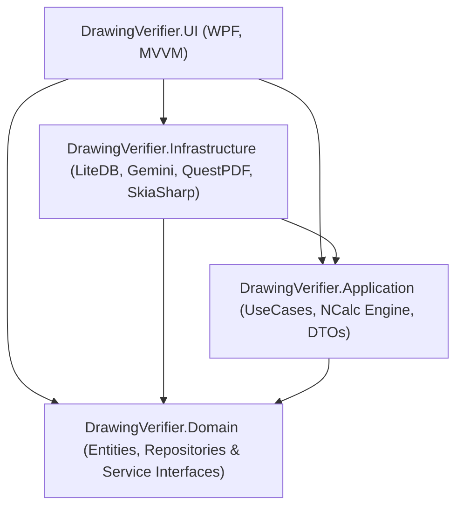
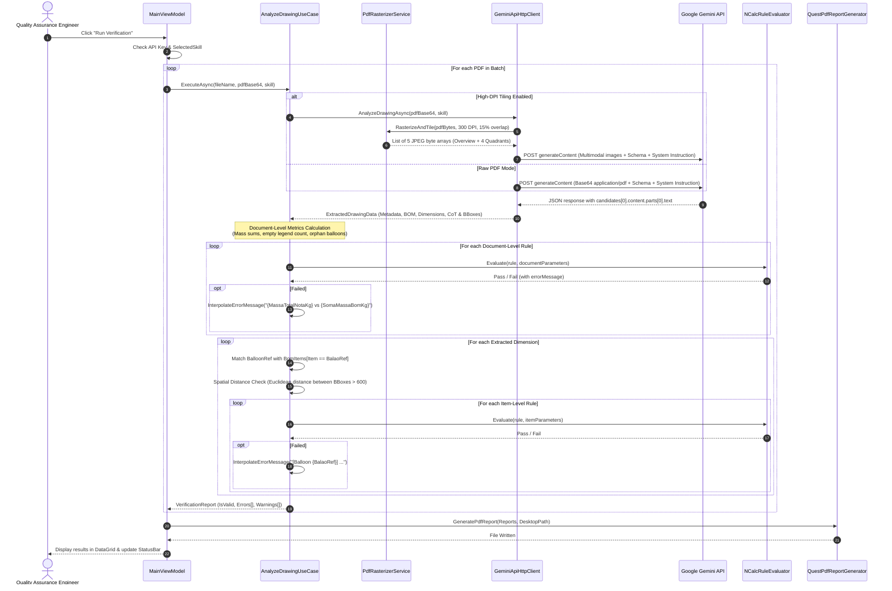

# DrawingVerifier - Architecture & Technical Design

This document details the architectural principles, system design, data flow, and design patterns implemented in **DrawingVerifier**.

---

## 1. Architectural Principles

DrawingVerifier is engineered following **Clean Architecture** (Robert C. Martin) and the **MVVM (Model-View-ViewModel)** design pattern. The primary goals are:
- **Independence of Frameworks:** Domain rules do not depend on external databases, UI frameworks, or third-party AI APIs.
- **Testability:** Business rules and evaluation logic can be verified in isolation with fast unit tests without spinning up a UI or network calls.
- **Extensibility:** AI engines, persistence mechanisms, or report generators can be swapped by implementing domain/application interfaces.

---

## 2. Project & Layer Structure

### 2.1 `DrawingVerifier.Domain`
The core business domain. Contains zero external NuGet dependencies and targets `.NET 9`.

- **Entities & Records:**
  - `VerificationSkill`: Encapsulates a client profile, including its unique name, system prompt, output JSON Schema, and associated validation rules collection.
  - `ValidationRule`: Encapsulates a single mathematical/logical rule, its NCalc expression string, error message template, and ID.
  - `ExtractedDrawingData`: Root record deserialized from the Gemini AI structured response. Contains `DrawingMetadata`, `List<ExtractedBomItem>`, and `List<ExtractedDimension>`.
  - `DrawingMetadata`: Drawing-level information from title block and notes (Client, Drawing Number, Revision, Drawn By, Approved By, Total Mass Note in kg, Presence of Weld/Roughness/Plate reference blocks, Count of unconnected duct ends).
  - `ExtractedBomItem`: Bill of Materials item (Item number, Quantity, Description, Raw dimensions string, BOM diameter, BOM thickness, BOM cut length, Unit mass, Has balloon in views).
  - `ExtractedDimension`: Geometric dimension extracted from drawing views (Balloon reference, Base dimension mm, Overmetal value mm, Has overmetal flag, View diameter, View thickness, Visual Chain-of-Thought reasoning string, Balloon bounding box `[ymin, xmin, ymax, xmax]`, Dimension bounding box `[ymin, xmin, ymax, xmax]`).
- **Interfaces:**
  - `ISkillRepository`: Asynchronous CRUD contract for managing `VerificationSkill` objects.
  - `IGeminiApiService`: Contract for submitting PDF base64 payloads and receiving structured `ExtractedDrawingData`.

### 2.2 `DrawingVerifier.Application`
Coordinates domain logic, orchestrates workflows, and evaluates dynamic rules.

- **Use Cases:**
  - `AnalyzeDrawingUseCase`: The central application orchestrator. Receives the PDF Base64 string, calls `IGeminiApiService`, partitions validation rules into document-level and item-level sets, checks spatial bounding box distance, executes the rules engine, interpolates dynamic parameter values into error messages, and constructs a consolidated `VerificationReport`.
- **Services & Interfaces:**
  - `IRuleEvaluator`: Abstraction for evaluating expressions against parameter dictionaries.
  - `NCalcRuleEvaluator`: Concrete implementation using `NCalcSync` 7.2. Provides case-insensitive parameter injection, boolean evaluation, and error catching.
  - `ISettingsService`: Contract for loading and saving the API key, model selection, and high-DPI tiling preference.
  - `IReportGenerator`: Contract for generating PDF audit documents.
- **DTOs:**
  - `VerificationReport`: Represents the result of verifying a drawing, holding the file name, skill name, boolean validity status, list of errors, and list of warnings.

### 2.3 `DrawingVerifier.Infrastructure`
Handles external technologies, hardware-specific features, I/O, and external APIs.

- **AI Integration (`DrawingVerifier.Infrastructure.Gemini`):**
  - `GeminiApiHttpClient`: Custom HTTP client targeting Google Gemini Generative Language API (`/v1beta/models/{model}:generateContent`). Handles structured JSON schema mapping (`response_mime_type: "application/json"`, `response_schema`), temperature clamping (0.0 for deterministic output), system instruction injection, and multimodal multipart payloads.
- **Image Processing (`DrawingVerifier.Infrastructure.Services`):**
  - `PdfRasterizerService`: Uses `PDFtoImage` and `SkiaSharp` to convert vector PDF pages into 300 DPI high-resolution bitmaps and subdivide them into 4 spatial quadrants with 15% overlap plus an overview image.
- **Persistence (`DrawingVerifier.Infrastructure.Data`):**
  - `SkillLiteDbRepository`: Embedded NoSQL document database using `LiteDB 5.0`. Stores skill profiles locally in `%LocalAppData%\DrawingVerifier\DrawingVerifier.db`.
  - `DatabaseSeeder`: Automatically seeds default skills (such as "Stainless Steel Ducts") and runs non-destructive schema migrations when new fields (such as `raciocinioVisual` or updated prompt strategies) are introduced.
- **Security & Settings:**
  - `WindowsSettingsService`: Encrypts the Gemini API key using `System.Security.Cryptography.ProtectedData` (Windows DPAPI) and persists non-sensitive preferences in `appsettings.json`.
- **Reporting:**
  - `QuestPdfReportGenerator`: Uses `QuestPDF` fluent API to generate vector-grade A4 compliance reports summarizing verification results, errors, and warnings.

### 2.4 `DrawingVerifier.UI`
Presentation layer built with Windows Presentation Foundation (WPF) and .NET 9.

- **Pattern:** MVVM (Model-View-ViewModel) using `CommunityToolkit.Mvvm`.
- **ViewModels:**
  - `MainViewModel`: Handles skill selection, batch PDF file management, asynchronous execution with progress updates, and desktop report saving.
  - `SettingsViewModel`: Binds API key, Gemini model selection, and high-DPI quadrant tiling toggle.
  - `SkillManagerViewModel`: Full CRUD interface for skills, prompt editing, JSON Schema editing, and inline NCalc rule editing with a DataGrid.
- **Dependency Injection:**
  - `App.xaml.cs` configures the `Microsoft.Extensions.DependencyInjection` service container, registers singletons and transients, wires unhandled exception handlers, and seeds the database upon startup.

---

## 3. Detailed Data Flow Sequence

The diagram below illustrates the exact execution path when a user clicks **Run Verification**:

---

## 4. Key Design Decisions & Rationale

### 4.1 Hybrid Architecture (AI Extraction + Deterministic Code Evaluation)
- **Problem:** LLMs are prone to arithmetic hallucination (e.g., verifying whether `540 + 100 == 640` or calculating mass percentage differences).
- **Solution:** Gemini is strictly limited to what vision models excel at: **visual data extraction and visual chain-of-thought parsing**. All mathematical, geometric, and business validation is offloaded to a deterministic C# rules engine (`NCalc`).

### 4.2 High-DPI Multimodal Tiling (300 DPI)
- **Problem:** Industrial drawings are frequently drafted in large sheets (A0: 841 x 1189 mm, A1: 594 x 841 mm). Direct PDF ingestion can cause vision models to downsample images, turning leader lines and fine decimal text unreadable.
- **Solution:** Rasterizing the PDF at 300 DPI yields images exceeding 10,000 pixels in dimension. We split the high-res bitmap into four spatial quadrants with a **15% overlapping margin** along the central axes, plus a scaled overview image. This guarantees that dimensions located near the sheet center are captured without truncation.

### 4.3 Spatial Bounding Box Validation
- **Problem:** In dense drawings with dozens of balloons, vision models can inadvertently associate a balloon callout with a neighboring segment's dimension line.
- **Solution:** The model extracts normalized bounding boxes `[ymin, xmin, ymax, xmax]` (integers 0–1000) for both the balloon circle and the dimension text. The use case calculates Euclidean centroid distance:
  $$\text{distance} = \sqrt{(\Delta X)^2 + (\Delta Y)^2}$$
  If $\text{distance} > 600$, the system generates a warning advising the engineer to verify leader line alignment.

### 4.4 Windows DPAPI for Secure Credential Storage
- **Problem:** Storing API keys in `.env`, `appsettings.json`, or registry keys poses a security vulnerability.
- **Solution:** Using `System.Security.Cryptography.ProtectedData.Protect` under `DataProtectionScope.CurrentUser` guarantees that keys are encrypted with user-specific OS credentials. The ciphered file (`settings.dat`) is marked with `FileAttributes.Hidden` under `%LocalAppData%\DrawingVerifier`.
