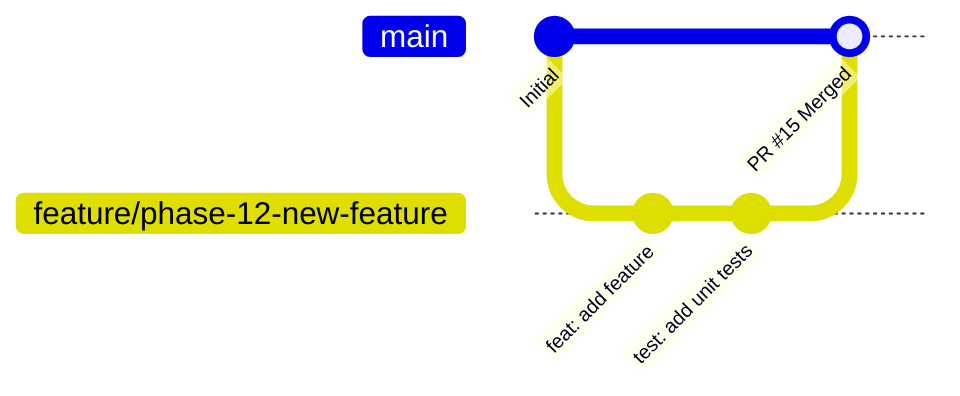

# Contributing to DrawingVerifier

Thank you for your interest in contributing to **DrawingVerifier**! This document outlines our development workflow, coding standards, branching strategy, and pull request guidelines.

---

## 1. Development Environment Setup

### Prerequisites
- **Operating System:** Windows 10 (Build 1809+) or Windows 11
- **.NET SDK:** [.NET 9.0 SDK](https://dotnet.microsoft.com/download/dotnet/9.0)
- **IDE:** Visual Studio 2022 (v17.12+ with *.NET Desktop Development* workload), JetBrains Rider, or VS Code with the C# Dev Kit extension.
- **Git:** Git for Windows (v2.40+)

### Initial Setup
```powershell
# Clone the repository
git clone https://github.com/gmataleite/DrawingVerifier.git
cd DrawingVerifier

# Restore NuGet dependencies
dotnet restore

# Build the solution
dotnet build

# Run the test suite
dotnet test
```

---

## 2. Git Branching & Workflow Rules

All developers and autonomous agents **must** adhere strictly to the following Git workflow:



1. **Never commit directly to `main` or `master`:**
   - Always create and checkout an isolated topic branch before writing any code.
   - Naming convention:
     - Features: `feature/phase-X-short-description` or `feature/short-description`
     - Bug fixes: `fix/issue-description`
     - Documentation: `docs/short-description`
2. **Build & Test Validation:**
   - Ensure the solution compiles with 0 errors (`dotnet build`) before every commit.
   - Ensure all existing and new unit tests pass (`dotnet test`).
3. **Commit Granularity:**
   - Keep commits logical, focused, and atomic.
   - Adhere to the [Conventional Commits](https://www.conventionalcommits.org/) specification:
     - `feat: add spatial bounding box proximity validation`
     - `fix: correct NCalc parameter casing in item evaluation`
     - `docs: update rules engine guide with overmetal examples`
     - `test: add unit tests for DatabaseSeeder migration`
     - `refactor: optimize SkiaSharp quadrant cropping allocations`
4. **Pull Requests:**
   - Push your branch to the remote repository (`git push -u origin <branch-name>`).
   - Open a Pull Request targeting the `main` branch.
   - Merging into `main` requires peer code review and passing CI builds.

---

## 3. Clean Architecture Guidelines

When adding new features, respect the architectural boundaries:

- **`DrawingVerifier.Domain`:**
  - Contains entities, value objects, and repository/service interfaces.
  - **Zero external dependencies.** Never add UI or third-party libraries (such as LiteDB, WPF, or QuestPDF) to this project.
- **`DrawingVerifier.Application`:**
  - Houses use cases and orchestration logic (`AnalyzeDrawingUseCase`).
  - Depends only on `Domain` and lightweight abstraction packages (`NCalcSync`, `System.Text.Json`).
- **`DrawingVerifier.Infrastructure`:**
  - Implements interfaces defined in Domain and Application (`SkillLiteDbRepository`, `GeminiApiHttpClient`, `QuestPdfReportGenerator`, `WindowsSettingsService`, `PdfRasterizerService`).
  - Contains third-party SDKs, database drivers, and native Windows interop.
- **`DrawingVerifier.UI`:**
  - WPF application containing Views and ViewModels.
  - Uses `CommunityToolkit.Mvvm` source generators (`[ObservableProperty]`, `[RelayCommand]`).
  - Business logic belongs in Application use cases, not in ViewModels.

---

## 4. Testing Standards

- **Test Framework:** xUnit with .NET 9.
- **Project:** `tests/DrawingVerifier.Tests/`
- **Naming Convention:** `[UnitOfWork]_[Scenario]_[ExpectedResult]`
  - Example: `AnalyzeDrawingUseCase_WhenOvermetalIsNot100_ReturnsValidationError`
  - Example: `NCalcRuleEvaluator_WithValidExpression_ReturnsTrue`
- **Mocking & Isolation:** Use interface implementations or lightweight in-memory stubs for external dependencies (`IGeminiApiService`, `ISkillRepository`, `ISettingsService`).
- **Target Coverage:** All business use cases and rule evaluation logic must have accompanying automated unit tests.

---

## 5. Continuous Integration & Release Process

- **CI Pipeline (`.github/workflows/ci.yml`):**
  - Triggers on every Pull Request against `main`.
  - Runs on `windows-latest` to validate WPF compilation and project builds.
- **Automated CD Release (`.github/workflows/release.yml`):**
  - Managed via version bumping in `Directory.Build.props`:
    ```xml
    <Project>
      <PropertyGroup>
        <Version>1.4.0</Version>
        <AssemblyVersion>1.4.0.0</AssemblyVersion>
        <FileVersion>1.4.0.0</FileVersion>
        <InformationalVersion>1.4.0</InformationalVersion>
      </PropertyGroup>
    </Project>
    ```
  - When merged to `main` with a bumped version number, GitHub Actions automatically builds the self-contained win-x64 executable, packages a `.zip` archive, and publishes a new GitHub Release with changelog notes.
