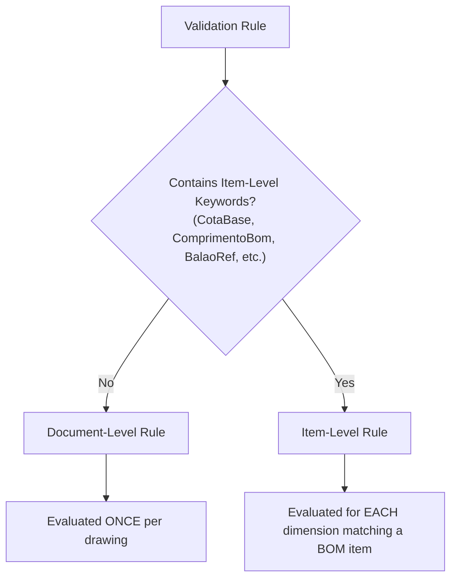

# DrawingVerifier - Dynamic Rules Engine Guide

This document is the complete reference guide for writing, testing, and debugging mathematical and compliance validation rules in **DrawingVerifier**.

---

## 1. Overview

DrawingVerifier uses **NCalc** (`NCalcSync`), a fast and extensible mathematical and logical expression evaluator for .NET. 

Rather than hard-coding business rules into compiled C# code, rules are stored as dynamic formulas inside each **VerificationSkill**. This allows engineering teams to modify validation thresholds, tolerances, and standards without recompiling or redeploying the application.

---

## 2. Rule Classification

The engine distinguishes between two tiers of rules based on the variables referenced in the expression:



### 2.1 Document-Level Rules
- Evaluated **once per drawing**.
- Applied to drawing-wide metrics, title block contents, mass notes, welding blocks, and overall BOM integrity.
- Examples: checking whether the title block was approved, checking if the approximate mass note was left blank, or ensuring all BOM items have balloons.

### 2.2 Item-Level Rules
- Evaluated **iteratively for each extracted geometric dimension** that corresponds to an item in the Bill of Materials (matched via `BalaoRef == BomItem.Item`).
- Applied to segment-specific parameters: cut length, overmetal excess, plate thickness, and diameter checks.
- If a rule references any of the following keywords, it is automatically categorized as item-level:
  - `CotaBase` / `BaseDimension`
  - `ComprimentoBom` / `BomDimension`
  - `PossuiSobremetal`
  - `ValorSobremetal`
  - `DiametroVista` / `DiametroBom`
  - `EspessuraVista` / `EspessuraBom`
  - `Quantidade` / `Quantity`
  - `BalaoRef` / `BalloonRef` / `Item`

---

## 3. Parameter Dictionary Reference

Below is the complete catalog of parameters available for use in expressions and error message templates. All parameter names are case-insensitive.

### 3.1 Document-Level Parameters

| Parameter Name | Type | Description |
| :--- | :--- | :--- |
| `MassaTotalNotaKg` | `double` | Total mass extracted from the approximate mass general note (in kg). Returns `0.0` if missing. |
| `SomaMassaBomKg` | `double` | Sum of all BOM items' calculated total mass: $\sum (\text{Quantidade} \times \text{MassaUnitariaKg})$. |
| `CamposLegendaVaziosCount` | `int` | Number of missing mandatory title block fields (`Cliente`, `NumeroDesenho`, `DesenhadoPor`, `AprovadoPor`). |
| `PossuiBlocoSoldaTopo` | `bool` | True if the Butt Weld standard technical block is present on the drawing sheet. |
| `PossuiBlocoRugosidade` | `bool` | True if the Surface Roughness block (0.8µm) is present on the sheet. |
| `PossuiBlocoReferenciaChapas` | `bool` | True if the Sheet Reference standard block is present on the sheet. |
| `ExtremidadesSemConexao` | `int` | Count of open duct ends lacking connection leader notes indicating mating equipment. |
| `ItensBomSemBalaoCount` | `int` | Count of Bill of Materials rows where `PossuiBalaoNasVistas == false`. |

### 3.2 Item-Level Parameters

*(All document-level parameters are also accessible within item-level rules).*

| Parameter Name | Type | Description |
| :--- | :--- | :--- |
| `BalaoRef` | `int` | Numeric balloon reference ID (e.g., `1`, `5`, `12`). |
| `PossuiSobremetal` | `bool` | True if the view dimension specifically denotes excess material / overmetal (e.g., `"+ 100 (Sobremetal)"`). |
| `ValorSobremetal` | `double` | Value of the overmetal stated on the view (in mm). Standard is `100.0`. |
| `CotaBase` | `double` | Nominal finished dimension stated on the view segment (in mm). |
| `ComprimentoBom` | `double` | Raw cut length from the matching Bill of Materials row (in mm). |
| `DiametroVista` | `double` | Internal or nominal diameter quoted on the view (in mm). |
| `DiametroBom` | `double` | Diameter quoted in the matching Bill of Materials row (in mm). |
| `EspessuraVista` | `double` | Plate/wall thickness quoted on the view (in mm). |
| `EspessuraBom` | `double` | Plate/wall thickness declared in the BOM (in mm). |
| `Quantidade` | `int` | Declared quantity in the matching BOM row (`QTDE`). |

---

## 4. NCalc Syntax & Supported Functions

### 4.1 Operators
- **Comparison:** `==`, `!=`, `<`, `<=`, `>`, `>=`
- **Logical:** `&&` (and), `||` (or), `!` (not)
- **Arithmetic:** `+`, `-`, `*`, `/`, `%`
- **Conditional:** `if(condition, valueIfTrue, valueIfFalse)`

### 4.2 Built-in Mathematical Functions
- `Abs(x)`: Absolute value
- `Min(x, y)`: Minimum value
- `Max(x, y)`: Maximum value
- `Round(x, decimals)`: Rounds to specified decimal precision
- `Floor(x)`: Floor integer
- `Ceiling(x)`: Ceiling integer
- `Sqrt(x)`: Square root
- `Pow(base, exponent)`: Exponential power

> [!NOTE]
> In NCalc, expressions must evaluate to a **boolean (`true` or `false`)**. If an expression evaluates to `true`, the check has passed. If it evaluates to `false`, an error is recorded using the rule's `ErrorMessage`.

---

## 5. Dynamic Error Message Template Interpolation

Error messages support dynamic parameter substitution using `{ParameterName}` placeholders. When a rule fails, the engine substitutes the placeholder with the exact value extracted during analysis.

### Example:
**Rule Name:** `Overmetal Length Math`  
**Expression:**
```csharp
if(PossuiSobremetal && CotaBase > 0 && ComprimentoBom > 0, ComprimentoBom == CotaBase + 100, true)
```
**Template Error Message:**
```
[Balloon {BalaoRef}] BOM cut length does not match view dimension. (View: {CotaBase} + 100. BOM: {ComprimentoBom}mm).
```
**Interpolated Output at Runtime:**
```
[Balloon 3] BOM cut length does not match view dimension. (View: 540 + 100. BOM: 600mm).
```

---

## 6. Real-World Rule Recipes

### Recipe 1: Enforcing Fixed 100mm Overmetal
Industrial duct standards require straight duct segments to have exactly 100mm overmetal for field adjustment. If a draftsman accidentally places +50mm or forgets overmetal on an elbow:
```csharp
if(PossuiSobremetal, ValorSobremetal == 100, true)
```
*Message:* `[Balloon {BalaoRef}] Out of standard: Overmetal indicated on view is {ValorSobremetal}mm (Expected: 100mm).`

### Recipe 2: Mass Consistency (5% Tolerance)
Checks whether the approximate total mass note matches the sum of the BOM items within a 5% margin:
```csharp
if(MassaTotalNotaKg > 0 && SomaMassaBomKg > 0, Abs(MassaTotalNotaKg - SomaMassaBomKg) < (MassaTotalNotaKg * 0.05), true)
```
*Message:* `Warning: Declared mass in note ({MassaTotalNotaKg}kg) deviates by more than 5% from BOM items total ({SomaMassaBomKg}kg).`

### Recipe 3: Mandatory Title Block Completeness
Ensures all four key roles (Client, Drawing Number, Drawn By, Approved By) are non-empty:
```csharp
CamposLegendaVaziosCount == 0
```
*Message:* `Mandatory title block information is missing. Check: Client, Drawing No., Drawn By, or Approved By.`

### Recipe 4: Verifying That All BOM Items Are Ballooned
Ensures there are no orphan BOM items that lack visual identification in the drawing views:
```csharp
ItensBomSemBalaoCount == 0
```
*Message:* `There are {ItensBomSemBalaoCount} item(s) in the Bill of Materials without indicative balloons on the views.`

### Recipe 5: Ensuring Diameter Agreement
Verifies that duct diameter callouts on views match BOM dimensions:
```csharp
if(DiametroVista > 0 && DiametroBom > 0, DiametroVista == DiametroBom, true)
```
*Message:* `[Balloon {BalaoRef}] Diameter mismatch. (View: Ø{DiametroVista}. BOM: Ø{DiametroBom}).`
