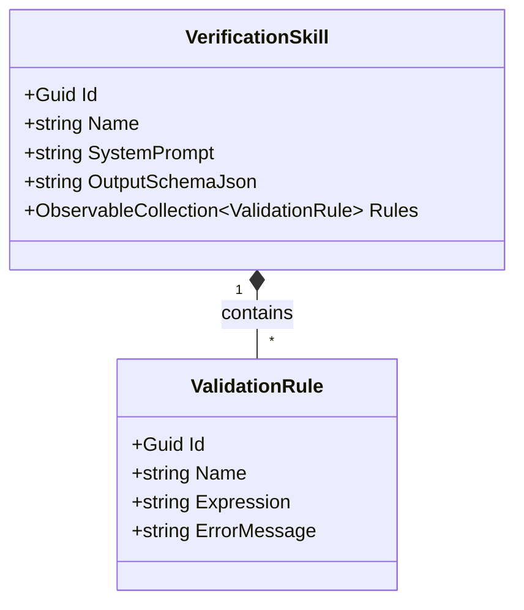

# DrawingVerifier - Skills & Profiles Guide

This guide explains how to design, manage, and optimize **Verification Skills** (client profiles) in DrawingVerifier.

---

## 1. What is a Verification Skill?

In DrawingVerifier, a **Verification Skill** is a self-contained domain profile that customizes how technical drawings are audited. Each engineering firm, client, or manufacturing standard has specific drawing conventions, tolerance thresholds, and title block layouts. 

A Skill encapsulates:
1. **Name:** A descriptive profile identifier (e.g., `"Stainless Steel Ducts"`, `"Heavy Structural Steel"`, `"Piping Spools - API 5L"`).
2. **System Prompt:** Specialized natural language instructions provided to Google Gemini directing its visual inspection strategy.
3. **Output Schema (JSON):** A strict JSON Schema definition defining the structured JSON payload Gemini must generate.
4. **Validation Rules Collection:** An observable list of NCalc mathematical and boolean validation rules.

All skills are stored locally in the embedded **LiteDB** database (`%LocalAppData%\DrawingVerifier\DrawingVerifier.db`).

---

## 2. Anatomy of a Verification Skill



### 2.1 The System Prompt
The system prompt establishes the persona, reading priority, and visual inspection guidelines for the multimodal vision model.

Key aspects included in the default system prompt:
- **Audit Order:** Directs the model to inspect the **Title Block** and **Bill of Materials (BOM)** first to anchor its data baseline before parsing complex views.
- **Visual Chain-of-Thought (CoT):** Requires the model to articulate its visual reasoning step by step, explicitly describing the path from a balloon circle along its leader line to the exact metal segment and its adjacent dimension line.
- **Bounding Box Extraction:** Instructs the model to locate both the balloon callout and the dimension text, returning normalized coordinates.
- **Overmetal & Dimension Checks:** Sets explicit guidelines on extracting nominal dimensions, overmetal flags, diameters, thicknesses, and weld blocks.

### 2.2 The JSON Output Schema
Gemini receives this JSON schema directly within its `generationConfig.response_schema` API parameter with `response_mime_type: "application/json"`. This forces the model to return 100% syntactically valid JSON conforming to the domain model:

```json
{
  "type": "object",
  "properties": {
    "metadata": {
      "type": "object",
      "properties": {
        "cliente": { "type": "string" },
        "numeroDesenho": { "type": "string" },
        "revisao": { "type": "string" },
        "desenhadoPor": { "type": "string" },
        "verificadoPor": { "type": "string" },
        "aprovadoPor": { "type": "string" },
        "massaTotalNotaKg": { "type": "number" },
        "possuiBlocoSoldaTopo": { "type": "boolean" },
        "possuiBlocoRugosidade": { "type": "boolean" },
        "possuiBlocoReferenciaChapas": { "type": "boolean" },
        "extremidadesSemConexao": { "type": "integer" }
      },
      "required": ["cliente", "numeroDesenho", "desenhadoPor"]
    },
    "bomItems": {
      "type": "array",
      "items": {
        "type": "object",
        "properties": {
          "item": { "type": "integer" },
          "quantidade": { "type": "integer" },
          "descricao": { "type": "string" },
          "dimensoesTextoBruto": { "type": "string" },
          "diametroBomMm": { "type": "number" },
          "espessuraBomMm": { "type": "number" },
          "comprimentoBomMm": { "type": "number" },
          "massaUnitariaKg": { "type": "number" },
          "possuiBalaoNasVistas": { "type": "boolean" }
        },
        "required": ["item", "quantidade"]
      }
    },
    "dimensions": {
      "type": "array",
      "items": {
        "type": "object",
        "properties": {
          "balaoRef": { "type": "integer" },
          "cotaBaseMm": { "type": "number" },
          "valorSobremetalMm": { "type": "number" },
          "possuiSobremetal": { "type": "boolean" },
          "diametroVistaMm": { "type": "number" },
          "espessuraVistaMm": { "type": "number" },
          "raciocinioVisual": { "type": "string" },
          "balaoBoundingBox": {
            "type": "array",
            "items": { "type": "integer" }
          },
          "cotaBoundingBox": {
            "type": "array",
            "items": { "type": "integer" }
          }
        },
        "required": ["balaoRef", "cotaBaseMm"]
      }
    }
  },
  "required": ["metadata", "bomItems", "dimensions"]
}
```

---

## 3. Visual Reasoning & Spatial Proximity

### 3.1 Chain-of-Thought (CoT) Tracing
In mechanical fabrication drawings, dense assemblies often place multiple dimensions near a single balloon. To eliminate wrong associations:
- The prompt instructs Gemini to write a step-by-step description in `raciocinioVisual` (e.g., *"Balloon 8 points via leader line down to the vertical straight duct; the dimension strictly parallel to this duct is 1821 + 100"*).
- Forcing the model to output this intermediate reasoning step significantly improves the accuracy of the extracted numeric dimensions.

### 3.2 Bounding Box Coordinate System
Bounding boxes are extracted as 4-element integer arrays:
$$\text{BoundingBox} = [y_{\min}, x_{\min}, y_{\max}, x_{\max}]$$
- Coordinates are normalized between `0` and `1000` relative to the image sheet dimensions.
- Example: `[450, 210, 485, 245]` represents an element located near the vertical center and left third of the sheet.

### 3.3 Spatial Distance Verification
During rule evaluation in `AnalyzeDrawingUseCase`, the system computes the Euclidean distance between the center of the balloon circle and the center of the dimension callout:

$$\text{Center}_{\text{Balloon}} = \left(\frac{x_{\min} + x_{\max}}{2}, \frac{y_{\min} + y_{\max}}{2}\right)$$
$$\text{Center}_{\text{Dimension}} = \left(\frac{x'_{\min} + x'_{\max}}{2}, \frac{y'_{\min} + y'_{\max}}{2}\right)$$
$$\text{Distance} = \sqrt{(\Delta X)^2 + (\Delta Y)^2}$$

If the computed distance exceeds **600 units**, DrawingVerifier flags a warning:
> `[Balloon 5] Spatial distance between balloon and dimension is unusually large (642 units). Verify leader line alignment.`

This warns the engineer if an extracted dimension is visually detached from its reference balloon.

---

## 4. Seeding & Database Migrations

When DrawingVerifier launches, `DatabaseSeeder.SeedDefaultSkills(repository)` is called automatically:
1. **New Database:** If no skill named `"Stainless Steel Ducts"` exists, the default skill is inserted with the complete set of 10 industrial validation rules, system prompt, and schema.
2. **Schema Migration:** If an existing skill is detected, the seeder checks whether it contains outdated rules or schemas (e.g., missing `raciocinioVisual` or fewer than 10 rules). If detected, it seamlessly upgrades the skill in-place without requiring manual database deletion.

---

## 5. Managing Skills in the UI

1. Open DrawingVerifier and click **Manage Skills**.
2. **Add New Skill:** Click **Add** in the left sidebar, enter a profile name, and customize the system prompt or output schema.
3. **Add Validation Rules:** In the **Validation Rules (NCalc)** section, click **Add Rule**, supply a descriptive name, NCalc boolean expression, and error message template.
4. **Save Changes:** Click **Save Changes** in the bottom-right corner. The updated profile is immediately synchronized to LiteDB and becomes active in the main window.
